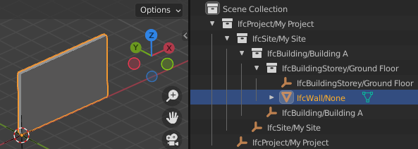
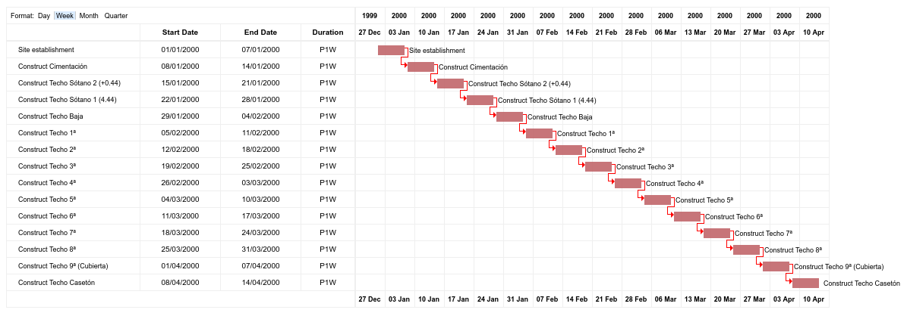

Code examples
=============

Examples for common basic tasks are shown here. In all examples, it is assumed
that you have a IFC model loaded into model variable like so:

.. snippet:: hello_world/load_model

This is only a small sample of common tasks. To view the full list of available
functions, check out the API Reference.

Get all entites (STEP ID items)
--------------------------------

IFC file opened through IfcOpenShell is iterable. This means you can get all instance (all STEP ID items) that occurs in the file with a simple loop.

.. snippet:: code_examples/all_entities
    :caption-js: ``model.ids`` lists the STEP IDs in ascending order.

Get all wall types
------------------

.. snippet:: code_examples/wall_types

Get all door occurrences of a type
----------------------------------

.. snippet:: code_examples/type_occurrences

Get the type of a wall
----------------------

.. snippet:: code_examples/element_type

Get the properties of a wall type
---------------------------------

.. snippet:: code_examples/element_properties
    :cpp: code_examples/navigate_relationships
    :js: code_examples/property_sets
    :caption-python: ``get_psets()`` also includes the properties inherited
        from the type of the element.
    :caption-js: This reads single-value properties of the element only.

.. snippet:: code_examples/type_properties
    :cpp: code_examples/properties_and_quantities#type-level

Find the spatial container of an element
----------------------------------------

.. snippet:: code_examples/spatial_container

Get all elements in a container
-------------------------------

.. snippet:: code_examples/container_elements
    :caption-python: ``get_decomposition()`` also includes the parts of
        aggregates and the contents of nested spatial elements.
    :caption-js: This follows the direct containment only.

Get the XYZ coordinates of a element
------------------------------------

.. snippet:: code_examples/placement

Get the geometry of an element
------------------------------

See :doc:`Geometry processing<geometry_processing>` for details.

Get the classification of an element
------------------------------------

.. snippet:: code_examples/classification

Convert to and from SI units and project units
----------------------------------------------

.. snippet:: code_examples/units
    :caption-js: There is no unit conversion helper in JavaScript yet. The
        scale follows from the length unit: for millimetres, the ``Prefix`` is
        ``MILLI`` and the ``Name`` is ``METRE``.

Get the distribution system of an element
-----------------------------------------

.. snippet:: code_examples/distribution_system

Copy an entity instance
-----------------------

Copy an entity instance is possible in different ways, depending on the task.

.. snippet:: code_examples/copy_class
    :na: cpp, js

This is high level and makes sensible assumptions about copying things like properties and quantities. It does not copy the element's representation, however.

.. snippet:: code_examples/copy_shallow
    :na: cpp, js

This is for shallow copies.  That is, associated things like the element's type, materials, and properties are not copied.  The new element, however, has the same representation and placement as the original.

.. snippet:: code_examples/copy_deep
    :na: cpp, js

This is for deep graph copy.  Like shallow copy, it does not copy over things like associated type/properties/quantities, but it does copy the representation and placement.

Also note that ifcopenshell.file.add() can be used to copy instances from one file to the other.

.. snippet:: hello_world/copy_instance

Note that, in this case, it does copy over recursively, however, it does not make any other attempts at resulting in a valid file. Factor in things like length unit conversion if both files (f and g) have project length unit defined.

Create a simple model from scratch
----------------------------------

.. snippet:: code_examples/simple_model
    :caption-python: This uses the authoring API, ``ifcopenshell.api``, which
        is only available in Python.

Here is the result:

Create a work schedule constructing a building floor by floor
-------------------------------------------------------------

.. snippet:: code_examples/work_schedule
    :na: cpp, js

Here is the result:

