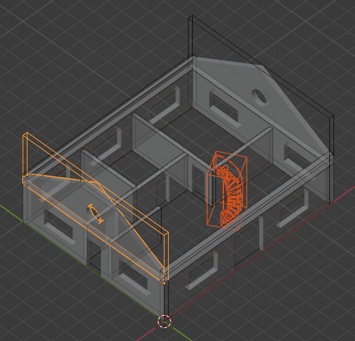

Geometry tree
=============

IfcOpenShell includes a utility to build trees of geometry and their bounding
boxes. Geometry trees can be used to efficiently select geometry or collide
geometry with one another.

The most efficient way to build a tree is by using the iterator. The backend
passed to ``ifcopenshell.geom.tree()`` determines the type of tree: the
``opencascade.brep`` backend ingests native OpenCASCADE shapes and builds a
**UB Tree**, the ``opencascade.trianglebvh`` backend ingests triangulations
and builds a **BVH Tree**. The type of tree determines the type of operation
you can perform.

Building a tree
---------------

.. snippet:: geometry_tree/build_tree
    :js: geometry_tree/select_box#build
    :caption-js: ``addFile()`` adds every element of a model, and
        ``addIterator()`` adds the elements of a geometry iterator. Keep the
        model alive until the tree and its results are released.

Clashing or selecting geometry from a geometry tree
---------------------------------------------------

With a **BVH Tree** (``backend="opencascade.trianglebvh"``), you can
efficiently clash sets of elements with other elements.  You can find elements that intersect, collide, or are within a
clearance distance threshold of one another. There are three methods you can
use to clash elements in the tree. Each function collides one set of elements
with another set of elements.

- `Detecting intersection clashes between elements`_ detects when an element
  intersects with another element. This is the most common type of clash
  detection used when coordinating designs. For example, you might want to know
  if any pipes go through structural columns or beams.
- `Detecting collision clashes between elements`_ detects when an element
  touches another element. It is the fastest type of clash detection but does
  not consider the distance that an element goes inside another element. This
  considers surfaces only so it works on non-manifold geometry but will not
  detect if an element is completely within another element.
- `Detecting clearance clashes between elements`_ detects when an element comes
  near to another element within a clearance threshold. This is the slowest
  type of clash detection. It works on non-manifold geometry and does not
  consider inside vs outside. Elements like pipe and ducts with insulation,
  structural openings, and equipment will typically require clearance checks.

With a **UB Tree** (``backend="opencascade.brep"``, the default), you can
efficiently select geometry by specifying a point, radius, or bounding box. There are three methods you can use to select elements
in the tree.

- `Selecting elements using bounding boxes`_ lets you query for elements that
  contain a point or another element. However, it only checks the bounding box
  of elements instead of their exact geometry. This is the fastest approach and
  is recommended if you don't need precise geometry selection.
- `Selecting elements using precise geometry`_ lets you query for elements that
  contain a point, a sphere, or another element. This is similar to selecting
  using bounding boxes, but additionally considers the actual geometry of the
  element. This is slower but more precise.
- `Selecting elements using a ray`_ lets you query for elements that intersect
  with a ray.

Detecting intersection clashes between elements
-----------------------------------------------

``clash_intersection_many`` detects when an element intersects with or is
contained within another element.

.. snippet:: geometry_tree/clash_intersection

If you specify a ``tolerance`` value, intersections with a protrusion distance
smaller than this tolerance are excluded. It is recommended to specify a
non-zero tolerance to distinguish between when elements merely touch (e.g. a
GPO on a wall) versus if they are truly intersecting (e.g. a pipe going through
a beam).

If ``check_all`` is ``False``, the clash check will return as soon as an
intersection is found. This is faster but may not return the worst-case
protrusion distance. If you are not interested in the protrusion distance, it
is recommended to set this to ``False``. If you want the protrusion distance,
such as to prioritise which clashes are more severe, set this to ``True``.

This includes:

1. When an element X protrudes inside element Y, where element Y is manifold.
   In this case, a protrusion distance is calculated as the deepest point of
   element X to the closest surface of element Y. ``P1`` is defined as the XYZ
   coordinate on element X, and ``P2`` is defined as the nearest point on the
   surface of element Y.
2. When an element X pierces element Y, such that an edge of element X enters
   element Y and leaves through another face. In this case, a piercing distance
   is calculated as the distance where that edge is inside element Y. ``P1`` is
   defined as the point on an edge of element X which enters element Y, and
   ``P2`` is the point where that edge leaves element Y.
3. When neither X or Y is manifold, we cannot detect protrusion or piercing, so
   instead when X and Y have any touching face. This is the same as the
   ``clash_collision_many`` check below. The distance is considered to be zero
   and ignores your specified tolerance. ``P1`` and ``P2`` are equal and
   represent an arbitrary XYZ point where the two elements touch.

Detecting collision clashes between elements
--------------------------------------------

``clash_collision_many`` detects when the surface of an element collides with
another element. The surfaces may either merely touch (e.g. are coplanar) or
intersect.

.. snippet:: geometry_tree/clash_collision

A collision between two surface triangles may be "touching" or "intersecting".
Two touching triangles may be coplanar or merely have a single edge or vertex
touching the other triangle. An intersecting triangle will have at least one
edge that goes through the other triangle.

Detecting clearance clashes between elements
--------------------------------------------

``clash_clearance_many`` detects with the surface of an element comes within a
clearance distance threshold of another element.

.. snippet:: geometry_tree/clash_clearance

You cannot specify a ``clearance`` less than 0.

If ``check_all`` is ``False``, the clash check will return as soon as a
clearance violation is found. This is faster but may not return the worst-case
distance. If you only interested whether there is a clearance issue, it is
recommended to set this to ``False``. If you want the exact worst case
clearance distance, such as to prioritise which clashes are more severe, set
this to ``True``.

Selecting elements using bounding boxes
---------------------------------------

Elements may be queried using an axis aligned bounding box. An axis aligned
bounding box is the bounding box using global XYZ axes, not the element's local
XYZ axes. If you have a vertical construction project, this means that your
model should be oriented to project north to get the best results.

You may select all elements that have a bounding box containing the point with
XYZ coordinates of ``(0., 0., 0.)``.

.. snippet:: geometry_tree/select_box
    :js: geometry_tree/select_box#select
    :caption-js: ``selectBoxPoint()`` selects the elements whose bounding box
        contains a point.

.. note::

    All coordinates and length arguments must be specified in meters.

You may select all elements based on another element's bounding box. It will
return:

1. The queried element itself (i.e. a wall in this example)
2. Any elements fully contained by the wall
3. Any elements fully containing the wall
4. Any elements intersecting the wall

.. snippet:: geometry_tree/select_box
    :tag: element
    :title: Selecting by the bounding box of an element

You may also select elements that are completely within another element's
bounding box. It will return:

1. The queried element itself (i.e. a wall in this example)
2. Any elements fully contained by the wall

.. snippet:: geometry_tree/select_box
    :tag: completely_within
    :title: Selecting elements completely within a bounding box

Selecting elements using precise geometry
-----------------------------------------

You may select all elements that have geometry containing the point with XYZ
coordinates of ``(0., 0., 0.)``.

.. snippet:: geometry_tree/select_precise

.. note::

    All coordinates and length arguments must be specified in meters.

You may also select all elements that have geometry intsecting with a sphere,
represented by a centerpoint and a radius. This will return:

1. Any elements fully contained by the sphere
2. Any elements intersecting the sphere

.. snippet:: geometry_tree/select_precise
    :tag: sphere
    :title: Selecting elements within a sphere

You may select all elements based on another element's geometry. It will
return:

1. The queried element itself (i.e. a wall in this example)
2. Any elements fully contained by the wall
3. Any elements fully containing the wall
4. Any elements intersecting the wall

.. snippet:: geometry_tree/select_precise
    :tag: element
    :title: Selecting by the geometry of an element

You may also select elements that are completely within another element's
geometry. It will return:

1. The queried element itself (i.e. a wall in this example)
2. Any elements fully contained by the wall

.. snippet:: geometry_tree/select_precise
    :tag: completely_within
    :title: Selecting elements completely within the geometry of an element

Selecting elements using a ray
------------------------------

You may select all elements that intersect with a ray. A ray is not infinite,
but instead must have a length. The default length is 1000 meters.

This returns a list of ray intersection results, which contain information
about the element it intersects with along with the point of intersection. This
may mean that the same element is returned multiple times if it intersects
multiple times.

.. snippet:: geometry_tree/select_ray
    :js: geometry_tree/select_ray#select
