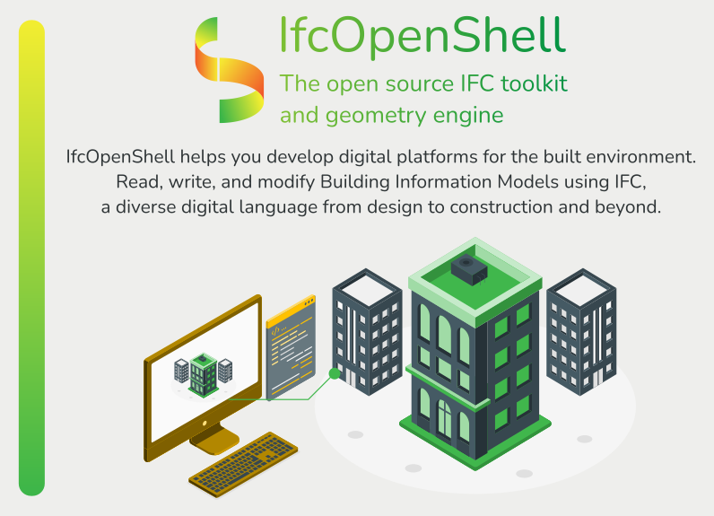

Let's learn IfcOpenShell!
=========================

IfcOpenShell is an open source library for reading, writing, and processing the
geometry of IFC models, and it is available in **C++**, **Python**, and
**JavaScript / TypeScript**. The same C++ core powers all three, so the
:doc:`Hello, world! <ifcopenshell/hello_world>` and :doc:`geometry processing
<ifcopenshell/geometry_processing>` guides explain each step once, with a C++,
Python, and JavaScript version of every snippet. Start with
:doc:`introduction`, or jump straight to :doc:`ifcopenshell-python`,
:doc:`ifcopenshell-cpp`, or :doc:`ifcopenshell-js`.

.. toctree::
   :hidden:
   :maxdepth: 1
   :caption: Main:

   introduction
   ifcopenshell
   ifcopenshell-cpp
   ifcopenshell-python
   ifcopenshell-js
   ifcconvert
   ifcviewer
   bonsai
   bonsai-viewer

.. toctree::
   :hidden:
   :maxdepth: 1
   :caption: Utilities:

   bcf
   bimserver-plugin
   bsdd
   ifc2ca
   ifc4d
   ifc5d
   ifccityjson
   ifcclash
   ifccsv
   ifcdiff
   ifcedit
   ifcfm
   ifcmax
   ifcmcp
   ifcpatch
   ifcquery
   ifcsverchok
   ifctester
   other

.. toctree::
   :hidden:
   :maxdepth: 1
   :caption: API:

   C++ API Reference <cpp-api>
   Python API Reference <autoapi/index>
   TypeScript API Reference <typescript-api>
   indices
