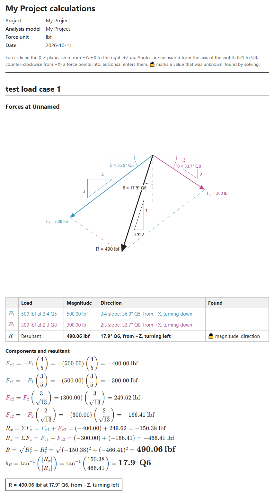
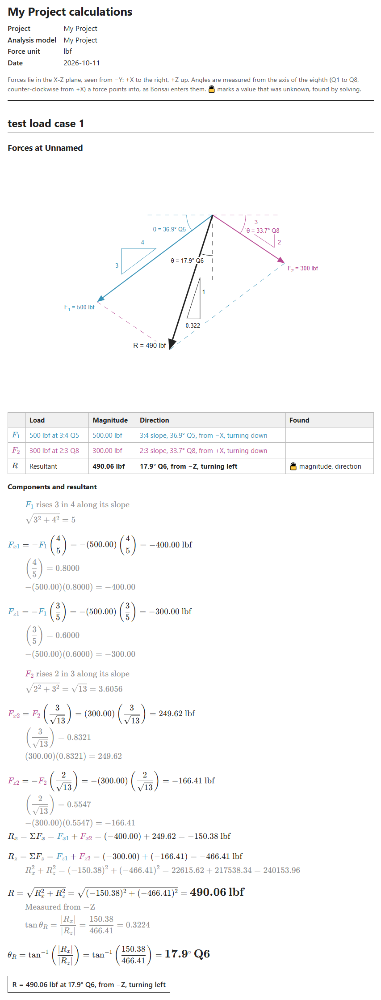

.. This file was generated with the assistance of an AI coding tool.

Calculation reports
===================

Bonsai can write the calculations for the point forces in an analysis model as a report: a
diagram of the forces at each point, a table of them, and the steps that add them up, set out
as a statics textbook would.

Exporting a report
------------------

1. Make the analysis model current in the **Structural Analysis Models** panel.
2. In the **Show Loads** panel, choose how the forces are drawn. The report's diagrams use
   the same settings as the viewport: components, parallelogram or tip to tail, angles,
   slopes and decimal places.
3. Turn on **Detailed Steps** to include the working between the main steps, in grey.
4. Click **Export Calculations** and choose a folder. Bonsai writes a ``<model>_calcs``
   folder there, opens its ``index.html`` in your browser, and also writes ``report.md``
   with the same content, for Git forges such as GitHub and Forgejo.

The HTML page renders its math with a copy of KaTeX that is bundled in the folder, so the
report reads offline and can be printed to PDF from the browser. Diagrams are SVG files in
``diagrams/``.

What a report contains
----------------------

For each load case, each point with forces gets:

- A **diagram** of the forces, drawn from the viewport's own drawing, with each force and
  component named as in the steps.
- A **table** of the forces and their resultant: magnitude, and direction as an angle from
  the axis of the eighth (Q1 to Q8) the force points into, or as a slope.
- The **steps**: each force's components, their sums along X and Z, and the resultant's
  magnitude and angle. Forces entered as a slope are resolved by the ratios of the slope's
  sides.

Values that were unknown and found with **Edit Resultant** are solved first, as the problem
was posed, and shown in bold. A point whose axes are tilted, as along an incline, also gets
its forces resolved along those axes, with a second diagram.

Example
-------

:download:`two-forces-on-slopes.ifc <files/two-forces-on-slopes.ifc>` has two forces on one
point: 500 lbf down and to the left on a 3:4 slope, and 300 lbf down and to the right on a
2:3 slope. Their resultant is found from their components.

   The report as exported

   With **Detailed Steps** on, each step's working is shown beneath it in grey
