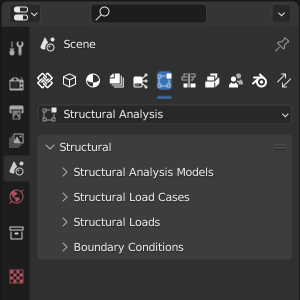

Structural Analysis
===================

.. include:: /_incomplete_message.rst

   Structural Analysis sub-tab.

Generate Structural Model (Beams & Columns)
-----------------------------------------

Select profile-based beams or columns and use **Generate from Selected** to
create linked structural curve members. Each supported element must have one
material and an extruded section. The member shares the section profile and
material with the element, and shares its profile set when one is assigned, so
editing shared data through either can affect both.

Members are joined only where their ends fall within the merge tolerance of
each other or of an existing point connection. Objects that cannot be
generated, including those that already have a structural member, are listed
in the report. Generation is available for IFC4 and IFC4X3.