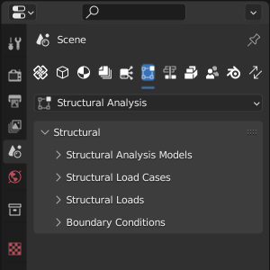

Structural Analysis
===================

.. include:: /_incomplete_message.rst

   Structural Analysis sub-tab.

Generate Structural Model (Beams & Columns)
-----------------------------------------

Select profile-based beams or columns and use **(Re)Generate from Selected** to
create linked structural curve members. Each supported element must have one
material and an extruded section. The member shares the section profile and
material with the element, and shares its profile set when one is assigned.
Editing shared data through either member or element can affect both, as well
as other elements using the same profile or material. An alternative section
cannot be tested independently by editing that shared data.

Select the physical beams or columns and use **(Re)Generate from Selected** to
refresh their members' axes, orientations, sections and materials. This can
overwrite manual changes to the analysis model, but does not update the
building. Generation is available for IFC4 and IFC4X3.